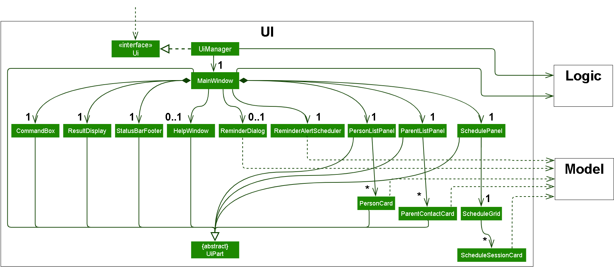
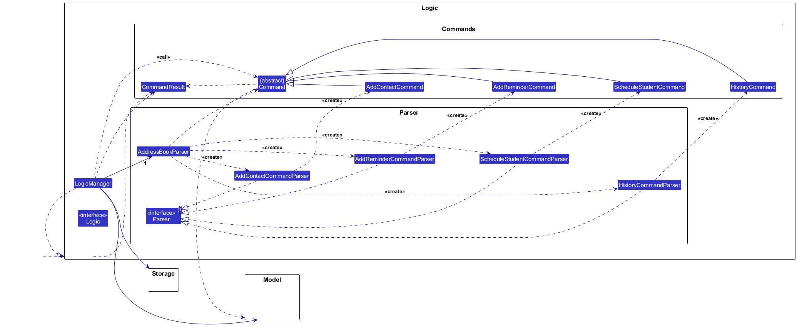
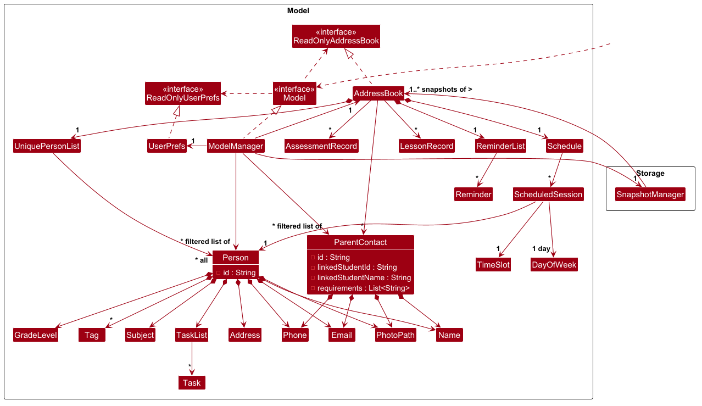
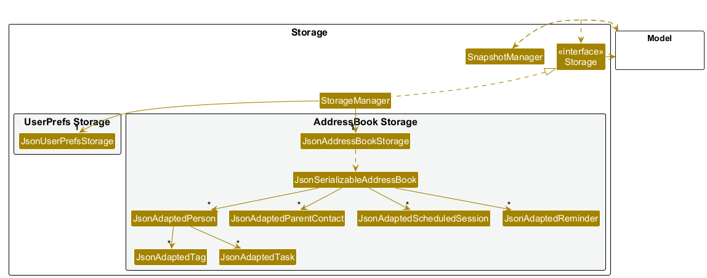

* Table of Contents
{:toc}

--------------------------------------------------------------------------------------------------------------------

## **Acknowledgements**

* _{List the sources of reused or adapted ideas, code, documentation, and third-party libraries here, with links to the originals.}_

--------------------------------------------------------------------------------------------------------------------

## **Setting up, getting started**

Refer to the guide [_Setting up and getting started_](SettingUp.md).

--------------------------------------------------------------------------------------------------------------------

## **Design**

:bulb: **Tip:** The `.puml` files used to create diagrams are in `docs/diagrams`. Refer to the [_PlantUML Tutorial_ at se-edu/guides](https://se-education.org/guides/tutorials/plantUml.html) to learn how to create and edit diagrams.

### Architecture

The ***Architecture Diagram*** given above explains the high-level design of the App.

The following provides a quick overview of the main components and their interactions.

**Main components of the architecture**

**`Main`** (consisting of classes [`Main`](https://github.com/se-edu/addressbook-level3/tree/master/src/main/java/seedu/address/Main.java) and [`MainApp`](https://github.com/se-edu/addressbook-level3/tree/master/src/main/java/seedu/address/MainApp.java)) is in charge of the app launch and shut down.
* At app launch, it initializes the other components in the correct sequence, and connects them up with each other.
* At shut down, it shuts down the other components and invokes cleanup methods where necessary.

The bulk of the app's work is done by the following four components:

* [**`UI`**](#ui-component): The UI of the App.
* [**`Logic`**](#logic-component): The command executor.
* [**`Model`**](#model-component): Holds the data of the App in memory.
* [**`Storage`**](#storage-component): Reads data from, and writes data to, the hard disk.

[**`Commons`**](#common-classes) represents a collection of classes used by multiple other components.

**How the architecture components interact with each other**

The *Sequence Diagram* below shows how the components interact with each other for the scenario where the user issues the command `delete 1`.

Each of the four main components (also shown in the diagram above),

* defines its *API* in an `interface` with the same name as the Component.
* provides its functionality through a concrete `{Component Name}Manager` class that implements the corresponding API interface.

For example, the `Logic` component defines its API in `Logic.java` and implements it in `LogicManager.java`. Other components interact with a component through its interface rather than its concrete class, preventing them from coupling to that component's implementation, as illustrated in the following partial class diagram.

The sections below give more details of each component.

### UI component

The **API** of this component is specified in [`Ui.java`](https://github.com/AY2627S1-CS2103T-F09-4/tp/blob/master/src/main/java/seedu/address/ui/Ui.java)

The UI consists of a `MainWindow` that is made up of parts such as `CommandBox`, `ResultDisplay`, `StatusBarFooter` and an optional `HelpWindow`. The main area of the window has three tabs, each shown by its own panel: `PersonListPanel` (Students), `ParentListPanel` (Parents) and `SchedulePanel` (Schedule). Each panel creates one card for every item it displays:

* `PersonListPanel` creates a `PersonCard` for each student.
* `ParentListPanel` creates a `ParentContactCard` for each parent contact.
* `SchedulePanel` uses a `ScheduleGrid` to arrange a `ScheduleSessionCard` for each scheduled session.

`MainWindow` also owns a `ReminderAlertScheduler`, which regularly checks whether any reminder has become due, and may show a `ReminderDialog` listing the reminders. `MainWindow`, its parts, the panels, `PersonCard` and `ParentContactCard` inherit from the abstract `UiPart` class, which captures common behavior among classes that represent visible GUI parts. `ScheduleGrid`, `ScheduleSessionCard`, `ReminderDialog` and `ReminderAlertScheduler` do not extend `UiPart`.

The `UI` component uses the JavaFX UI framework. The layouts of the `UiPart`s are defined in matching `.fxml` files in `src/main/resources/view`. For example, [`MainWindow.fxml`](https://github.com/AY2627S1-CS2103T-F09-4/tp/blob/master/src/main/resources/view/MainWindow.fxml) specifies the layout of [`MainWindow`](https://github.com/AY2627S1-CS2103T-F09-4/tp/blob/master/src/main/java/seedu/address/ui/MainWindow.java), including its three tabs. The contents of the timetable in `SchedulePanel` are laid out in code by `ScheduleGrid`.

The `UI` component,

* executes user commands using the `Logic` component. `CommandBox` passes the text the user enters to `MainWindow`, which calls `Logic#execute(String)` and shows the feedback in `ResultDisplay`. `MainWindow` also switches to the Students tab after `list` commands and to the Parents tab after parent commands such as `add-parent`.
* listens for changes to `Model` data so that the UI can be updated with the modified data. The panels observe the lists exposed by `Logic` (the displayed students, the parent contacts and the scheduled sessions), so they redraw automatically when the data changes.
* keeps a reference to the `Logic` component, because the `UI` relies on the `Logic` to execute commands and to obtain the data it displays.
* depends on some classes in the `Model` component because it displays `Person`, `ParentContact`, `ScheduledSession` and `Reminder` objects from the model.

#### Schedule tab

`SchedulePanel` shows the scheduled sessions as a weekly timetable with a legend below it. It redraws whenever the scheduled sessions, the students or the displayed student list change.

* `ScheduleGrid` draws one row for each day of the week, with time running from left to right. Each session becomes a `ScheduleSessionCard` placed according to its day and time slot.
* Cards snap to a 30-minute grid. A session whose times fall between grid lines is rounded outwards, so the card always covers the full session. Sessions that overlap on the same day are placed in separate lanes, which makes that day's row taller.
* Each student is given a colour based on their position in the student list, so all of a student's sessions share one colour. The legend lists the scheduled students and their colours.
* Each card shows the student's index in the displayed student list, name, subject, grade level, address and time slot. If a student is not in the displayed list, for example after a `find` command, the card shows only the name.

### Logic component

**API** : [`Logic.java`](https://github.com/se-edu/addressbook-level3/tree/master/src/main/java/seedu/address/logic/Logic.java)

Here's a (partial) class diagram of the `Logic` component:

The sequence diagram below illustrates the interactions within the `Logic` component, taking `execute("delete 1")` API call as an example.

:information_source: **Note:** The lifeline for `DeleteCommandParser` should end at the destroy marker (X), but due to a limitation of PlantUML, it continues to the end of the diagram.

How the `Logic` component works:

1. When `Logic` is called upon to execute a command, the command is passed to an `AddressBookParser` object, which in turn creates a parser that matches the command (e.g., `DeleteCommandParser`) and uses it to parse the command.
1. This results in a `Command` object (more precisely, an object of one of its subclasses e.g., `DeleteCommand`) which is executed by the `LogicManager`.
1. The command can communicate with the `Model` when it is executed (e.g. to delete a person). 
   Note that although this is shown as a single step in the diagram above for simplicity, the code can require several interactions between the command object and the `Model` to complete the operation.
1. The result of the command execution is encapsulated as a `CommandResult` object which is returned from `Logic`.

Here are the other classes in `Logic` (omitted from the class diagram above) that are used for parsing a user command:

How the parsing works:
* When called upon to parse a user command, the `AddressBookParser` class creates an `XYZCommandParser` (`XYZ` is a placeholder for the specific command name, e.g., `AddCommandParser`). The parser uses the other classes shown above to parse the user command and create an `XYZCommand` object (e.g., `AddCommand`). The `AddressBookParser` returns that object as a `Command` object.
* All `XYZCommandParser` classes, such as `AddCommandParser` and `DeleteCommandParser`, implement the `Parser` interface so they can be treated similarly where appropriate, for example during testing.

### Model component
**API** : [`Model.java`](https://github.com/se-edu/addressbook-level3/tree/master/src/main/java/seedu/address/model/Model.java)

The `Model` component,

* stores the address book data i.e., all `Person` objects (which are contained in a `UniquePersonList` object).
* stores the `Person` objects selected by the current filter, such as search results, in a separate _filtered_ list. It exposes this list as an unmodifiable `ObservableList<Person>` that the UI can observe and bind to, so the UI updates when the list changes.
* stores a `UserPrefs` object that represents the user’s preferences (currently, just the GUI settings). This is exposed to the outside as a `ReadOnlyUserPrefs` object.
* does not depend on any of the other three components (as the `Model` represents data entities of the domain, they should make sense on their own without depending on other components)

:information_source: **Note:** The alternative, arguably more object-oriented, design below keeps a unique list of tags in `AddressBook`, and each `Person` references tags from that list. This lets `AddressBook` maintain one `Tag` object per unique tag instead of each `Person` holding its own `Tag` objects. 

### Storage component

**API** : [`Storage.java`](https://github.com/se-edu/addressbook-level3/tree/master/src/main/java/seedu/address/storage/Storage.java)

The `Storage` component,
* can save both address book data and user preference data in JSON format, and read them back into corresponding objects.
* is implemented by `StorageManager`, which delegates the actual JSON file access to `JsonAddressBookStorage` and `JsonUserPrefsStorage` (one class per data file).
* depends on some classes in the `Model` component (because the `Storage` component's job is to save/retrieve objects that belong to the `Model`)

### Common classes

Classes used by multiple components are in the `seedu.address.commons` package.

--------------------------------------------------------------------------------------------------------------------

## **Implementation**

This section describes some noteworthy details on how certain features are implemented.

### Historical records and statistics

The statistics MVP measures teaching **workload, not profitability**. It has no payments, expenses, profit,
charts or exports. Reports derive from explicitly entered source history, never from the recurring weekly schedule.

**Model and identity.** `Person` now carries a persistent UUID `studentId`. New students receive a new UUID;
`AddressBook.setPerson` transfers the target identity to replacement details, covering edits, photos and tasks.
`Person.copy` preserves it. Existing detail-based `Person.equals`, hashing and name/phone duplicate detection remain
compatible with existing callers; historical relationships and distinct-student counts explicitly use `studentId`.
Student IDs are unique in a loaded address book and are never derived from mutable names or phone numbers.
The older parent-contact name/phone link mechanism is separate and is not migrated by this feature.

`model.statistics.LessonRecord` and `AssessmentRecord` are immutable Java records with their own UUID, student UUID
and recorded student name. Lessons contain a date, subject, start/end time and explicit outcome. Assessments retain
date, subject, category, title, score and maximum. The name snapshot makes orphan history identifiable after student
deletion; listings use the current name while the student exists. Deletion removes weekly sessions as before, but
does not remove history. Recreating a deleted student creates a different identity. `clear` explicitly clears everything.

`ReadOnlyAddressBook` exposes immutable historical lists with empty defaults. `AddressBook.setHistory` validates
unique record IDs and replaces both lists atomically. `Model.setHistory` exposes this mutation through `ModelManager`.
Reset, copy, equality and hashing include both collections; immutable records can be shared by snapshot copies.
Historical data is retained even when its student is no longer in the active student list.

**Commands and parsing.** `AddressBookParser` routes the history command family to `HistoryCommandParser` and
statistics to `StatsCommandParser`. They reuse `ArgumentTokenizer`, `ArgumentMultimap`, `ParserUtil.parseIndex`,
and `CommandException`/`ParseException`. Unknown and duplicate prefixes, missing or blank fields, invalid calendar
dates, non-HH:mm times, overnight/zero durations, invalid outcomes and invalid marks are rejected before mutation.
Future historical dates are checked at execution using `LocalDate.now(model.getClock())`, not wall-clock calls
inside parsers. New lessons snapshot the student's current subject. Corrections supply all editable fields and
retain record and student identities. Wrong-student corrections use delete and re-record.

Student-index operations use the displayed student list. Session and historical record numbers resolve against
their complete current collections in storage order, independent of student filters. Parsers use `ParserUtil.parseIndex`
for these positive integer arguments; execution rejects out-of-range numbers with instructions to list again.
UUID command arguments are no longer accepted. History lists and business reports use the complete address book.
`StatsCommand` and listing `HistoryCommand`s override `Command.isReadOnly`; `LogicManager` returns their
`CommandResult` without writing JSON or saving a snapshot. This is essential because saving a snapshot after undo
would otherwise discard the redo branch. Other commands retain their existing snapshot behavior.

**Calculations.** `StatisticsReport` is a pure formatter/calculator with no storage or UI dependencies. Completed
lessons alone contribute to business counts, duration and distinct student UUIDs. Calendar-month rows include zero
months and obey the requested inclusive dates. Attendance is completed / (completed + absent), excluding cancelled
and unrecorded entries. Zero denominators show N/A. Assessment groups use trimmed, case-insensitive subject and
category keys, ordered by date then UUID for same-date ties; each group compares its first and last percentages.
One or zero comparable records gives N/A. Marks use `BigDecimal`, intermediate percentages have twelve decimal places,
and displayed hours/percentages/changes round HALF_UP to two. Report defaults are January 1 through today from the
injected clock. Explicit boundaries must be supplied together and ordered. No totals are cached or persisted.

**Storage and compatibility.** `JsonAdaptedPerson` saves `studentId`; missing IDs in older JSON receive UUIDs when
loaded and are persisted on the next save. `JsonSerializableAddressBook` saves `lessonRecords` and `assessmentRecords`
through dedicated adapters. Absent collections default to empty; no records are inferred from schedules. Null or
structurally invalid records, duplicate record IDs and duplicate student IDs fail loading via `IllegalValueException`.
Deleted-student references are valid, so the loader deliberately does not require each historical UUID to refer to
an active student. Future-date validation uses the model clock at command execution; JSON adapters validate structural
constraints independently of the machine clock. Undo/redo snapshots preserve student IDs, historical UUIDs and records.

**Verification.** `StatisticsReportTest` covers workload, inclusive boundaries, zero cases, attendance, grouping,
same-date ties and percentage-point rounding. `StatisticsParserTest` covers malformed command input.
`StatisticsIntegrationTest` uses a fixed Asia/Singapore clock and temporary JSON storage to test filtered indices,
identity through edits/tasks/reload, deletions, corrections, undo/redo and read-only reports preserving redo and file
contents. `StatisticsStorageTest` covers old data, UUID uniqueness, immutable history, copy/reset/equality, malformed
records and deleted-student round trips. Manual smoke test: record a lesson and two assessments, run both reports,
undo a mutation, run reports and lists, then redo; delete the student and check retained identifiable history.

**MVP limits.** One lesson is one same-day interval. Repeated submissions create separate records; users must correct
duplicates explicitly. Student reports require an active displayed student; retained deleted-student history remains
available through lists and business totals. Historical lists show all entries and dates without pagination.

### Attendance linked to recurring sessions

`ScheduledSession.sessionId` is a persistent UUID for one weekly template belonging to one student. Fresh sessions
receive fresh IDs, including duplicate slots; `withStudent` retains the ID, so student edits and deep snapshot copies
preserve it. Equality and hashing include this identity plus session details. `isSameSlot` explicitly compares details
for the existing `unschedule-student` workflow: the command resolves and removes the first actual matching session.
`Schedule` rejects duplicate identities but allows overlapping or identical slots with distinct IDs.

`list-schedule` is a read-only command returning all sessions with one-based numbers through `CommandResult`, independent of
student filters. `MainWindow.selectTabForCommand` handles it before generic list routing, selecting the existing
Schedule tab; successful `mark-attendance` also selects that tab. Each `ScheduleSessionCard` shows a `Session #N` label
instead of a UUID field, separate from its `Student:` label. `ScheduleGrid` maps persistent session UUIDs to their
positions in the original list before sorting cards into weekday/time lanes, so timetable numbers match command output.
Cards retain their weekly layout. No dialog or separate attendance tab is introduced.

`MarkAttendanceCommandParser` reuses strict date parsing and the existing tokenizer, rejecting missing, unknown or
duplicate arguments. `MarkAttendanceCommand` accepts an `Index`, resolves against the complete schedule, then uses
the resolved session UUID internally. It checks
the requested weekday and future-date boundary using the model's injectable clock. Since weekly templates have no
effective start/end dates, any matching weekday on or before today can be recorded; today's time need not have passed.

`LessonRecord.sourceSessionId` is optional. First marking snapshots the student UUID/name, current subject and times
into a new dated lesson. Subsequent marking finds the same `(sourceSessionId, date)` and updates only its outcome,
preserving the historical UUID and details, including manual time/subject corrections. `AddressBook.setHistory`
rejects duplicate linked occurrences and student mismatches against active templates, while allowing retained links
to removed templates. `edit-lesson` retains the source ID and rejects date changes for linked history; tutors delete
and re-record mistaken dates. Manual records remain unlinked and are never inferred or merged automatically.

JSON adapters store `sessionId` and `sourceSessionId`. Missing session IDs migrate to UUIDs on loading and persist on
the next save; missing source links remain null. Malformed IDs, duplicate template IDs and duplicate linked occurrences
fail loading. Copy/reset and undo/redo retain both identities. Unscheduling or deleting a student keeps dated history;
rescheduling an identical slot creates a new template. Existing statistics calculate from lesson records unchanged:
unmarked occurrences create no records, counts or implicit absences.

`AttendanceIntegrationTest` verifies repeated marking, all outcomes, filters, clock boundaries, historical corrections,
undo/redo, reload, duplicate slots and retention. `AttendanceStorageTest` covers migration, immutable source links,
ID validation and equality. UI tests verify Schedule-tab routing, number labels on narrow cards, and numbering despite
timetable sorting. Manual check: schedule a session, run `list-schedule`, use its number to mark attendance for a
matching past date, then change the status
and confirm only one historical record exists. Undo, view the schedule, and redo to confirm listing preserves history.

**Displayed numbers versus identity.** Schedule, lesson and assessment lists each number their own complete collection
from 1 in insertion order. New entries append; edits retain their position. Deletion, unscheduling, reset and undo/redo
can shift numbers, so documentation tells users to list again before choosing a record. No display-number allocation
state or last-listed snapshot is persisted. UUIDs remain unchanged in model objects and JSON; no data migration is
needed for this interface change. Success messages and normal lists hide UUIDs and source links, the student statistics
heading uses the name only, and deleted students use `Name (deleted)`. Attendance, copying and undo/redo still resolve
relationships through persistent identities. Integration tests cover renumbering, independent historical lists,
filters, invalid targets, hidden UUIDs, reload, and redo surviving read-only listing.

### \[Proposed\] Undo/redo feature

#### Proposed Implementation

The proposed undo/redo mechanism is facilitated by `VersionedAddressBook`. It extends `AddressBook` with an undo/redo history, stored internally as an `addressBookStateList` and `currentStatePointer`. Additionally, it implements the following operations:

* `VersionedAddressBook#commit()` — Saves the current address book state in its history.
* `VersionedAddressBook#undo()` — Restores the previous address book state from its history.
* `VersionedAddressBook#redo()` — Restores a previously undone address book state from its history.

These operations are exposed in the `Model` interface as `Model#commitAddressBook()`, `Model#undoAddressBook()` and `Model#redoAddressBook()` respectively.

Given below is an example usage scenario and how the undo/redo mechanism behaves at each step.

Step 1. The user launches the application for the first time. The `VersionedAddressBook` will be initialized with the initial address book state, and the `currentStatePointer` pointing to that single address book state.

Step 2. The user executes `delete 5` command to delete the 5th person in the address book. The `delete` command calls `Model#commitAddressBook()`, causing the modified state of the address book after the `delete 5` command executes to be saved in the `addressBookStateList`, and the `currentStatePointer` is shifted to the newly inserted address book state.

Step 3. The user executes `add n/David …​` to add a new person. The `add` command also calls `Model#commitAddressBook()`, causing another modified address book state to be saved into the `addressBookStateList`.

:information_source: **Note:** If a command fails its execution, it will not call `Model#commitAddressBook()`, so the address book state will not be saved into the `addressBookStateList`.

Step 4. The user now decides that adding the person was a mistake, and decides to undo that action by executing the `undo` command. The `undo` command will call `Model#undoAddressBook()`, which will shift the `currentStatePointer` once to the left, pointing it to the previous address book state, and restores the address book to that state.

:information_source: **Note:** If the `currentStatePointer` is at index 0, pointing to the initial AddressBook state, then there are no previous AddressBook states to restore. The `undo` command uses `Model#canUndoAddressBook()` to check if this is the case. If so, it will return an error to the user rather
than attempting to perform the undo.

The following sequence diagram shows how an undo operation goes through the `Logic` component:

:information_source: **Note:** The lifeline for `UndoCommand` should end at the destroy marker (X), but due to a limitation of PlantUML, it continues to the end of the diagram.

Similarly, how an undo operation goes through the `Model` component is shown below:

The `redo` command does the opposite — it calls `Model#redoAddressBook()`, which shifts the `currentStatePointer` once to the right, pointing to the previously undone state, and restores the address book to that state.

:information_source: **Note:** If the `currentStatePointer` is at index `addressBookStateList.size() - 1`, pointing to the latest address book state, then there are no undone AddressBook states to restore. The `redo` command uses `Model#canRedoAddressBook()` to check if this is the case. If so, it will return an error to the user rather than attempting to perform the redo.

Step 5. The user then decides to execute the command `list`. Commands that do not modify the address book, such as `list`, will usually not call `Model#commitAddressBook()`, `Model#undoAddressBook()` or `Model#redoAddressBook()`. Thus, the `addressBookStateList` remains unchanged.

Step 6. The user executes `clear`, which calls `Model#commitAddressBook()`. Since the `currentStatePointer` is not pointing at the end of the `addressBookStateList`, all address book states after the `currentStatePointer` will be purged. Reason: It no longer makes sense to redo the `add n/David …​` command. This is the behavior that most modern desktop applications follow.

The following activity diagram summarizes what happens when a user executes a new command:

#### Design considerations:

**Aspect: How undo & redo execute:**

* **Alternative 1 (current choice):** Saves the entire address book.
  * Pros: Easy to implement.
  * Cons: May have performance issues in terms of memory usage.

* **Alternative 2:** Individual command knows how to undo/redo by
  itself.
  * Pros: Will use less memory (e.g. for `delete`, just save the person being deleted).
  * Cons: We must ensure that the implementation of each individual command is correct.

_{more aspects and alternatives to be added}_

### \[Proposed\] Data archiving

_{Explain here how the data archiving feature will be implemented}_

--------------------------------------------------------------------------------------------------------------------

## **Documentation, logging, testing, dev-ops**

* [Documentation guide](Documentation.md)
* [Testing guide](Testing.md)
* [Logging guide](Logging.md)
* [DevOps guide](DevOps.md)

--------------------------------------------------------------------------------------------------------------------

## **Appendix: Requirements**

### Product scope

**Target user profile**:

* needs to manage large numbers of contacts
* needs to manage different kinds of contacts (students, parents, coworkers)
* needs to manage information within contacts
* prefers desktop apps over other types of applications
* can type fast
* prefers typing to mouse interactions
* is reasonably comfortable using CLI apps

**Value proposition**: optimize creating and tracking student information, including classes, deliverables, improvement, parents, locations, etc.

### User stories

Priorities: High (must have) - `* * *`, Medium (nice to have) - `* *`, Low (unlikely to have) - `*`

| Priority | As a …​                          | I want to …​                                                                                    | So that I can…​                                                                                |
|----------|----------------------------------|-------------------------------------------------------------------------------------------------|------------------------------------------------------------------------------------------------|
| `* * *`  | user                             | do basic functionality like creating a student profile and adding and deleting data             | add / delete students and any info I submitted for them                                        |
| `* * *`  | regular user                     | add tasks to students                                                                           | know what each student's tasking are                                                           |
| `* * *`  | regular user                     | add parent profiles in addition to student ones                                                 | track their requirements as well                                                               |
| `* * *`  | regular user                     | add images                                                                                      | tell the students apart                                                                        |
| `* * *`  | regular user                     | search up information about my clients                                                          | See details about my clients                                                                   |
| `* *`    | first time user                  | have some sample data                                                                           | explore the features                                                                           |
| `* *`    | first time user                  | have user guide or help sheet                                                                   | know what features are available                                                               |
| `* *`    | user                             | edit already submitted data                                                                     | update the data I have in case things change                                                   |
| `* *`    | regular user                     | view dates as that little popup calendar instead of manually inputting dates                    | organize things easily and more efficiently                                                    |
| `* *`    | regular user                     | search for information based on keywords                                                        | quickly find it rather than comb through the entire app                                        |
| `* *`    | returning user                   | have suggested questions I can ask to make the app useful (payment, food, address, number, etc) | remember what I should do to make app useful                                                   |
| `* *`    | regular user                     | set some info the app will regularly remind me every time the app opens                         | not forget about them or where they might be, and have the functionality to close it as well   |
| `* *`    | experienced user                 | track my student's data and have it formatted into useful statistics                            | evaluate their performance                                                                     |
| `* *`    | tutor who is very forgetful      | recieve notifications about tasks that need my attention                                        | not be as sloppy in my work                                                                    |
| `* *`    | tutor                            | mark attendance for each scheduled session                                                      | have an accurate record of completed sessions                                                  |
| `* *`    | tutor who likes to procrastinate | organise tasks into an eisenhower matrix                                                        | know which tasks to prioritise                                                                 |
| `* *`    | regular user                     | filter and sort the student list by subject, grade level, etc                                   | quickly group and manage specific subsets of students                                          |
| `* *`    | power user                       | use keyboard shortcut commands for common actions                                               | navigate the application faster without relying on a mouse                                     |
| `* *`    | regular user                     | submit suggestions and feedback                                                                 | get changes that I want implemented                                                            |
| `* *`    | regular user                     | view the schedule of a day                                                                      | summarize activities I might have from multiple students                                       |
| `*`      | user who studies CS              | change the path of the app's data file                                                          | organize everything on my computer                                                             |
| `*`      | user with a bad sleep schedule   | view the app in a dark mode version of the ui                                                   | not hurt my eyes                                                                               |

### Use cases

(For all use cases below, the **System** is the `AddressBook` and the **Actor** is the `user`, unless specified otherwise)

**Use case: UC01 - Add a Student**

**MSS**

1.  User requests to add a student with specific details
2.  Tutoria adds the student and indicates success

    Use case ends.

**Extensions**

* 1a. User input is invalid
    * 1a1. Tutoria shows the relevant error message

    Use case ends.

**Use case: UC02 - Viewing a day's schedule**

**MSS**

1.  User requests to view the schedule of a specific date
2.  Tutoria shows the relevant information occurring on that date

    Use case ends.

**Extensions**

* 1a. User input is invalid
    * 1a1. Tutoria shows the relevant error message

  Use case ends.

* 2a. The date has no relevant information

    * 2a1. Tutoria shows that nothing is occurring on that date

    Use case ends.

**Use case: Delete a person**

**MSS**

1.  User requests to list persons
2.  AddressBook shows a list of persons
3.  User requests to delete a specific person in the list
4.  AddressBook deletes the person

    Use case ends.

**Extensions**

* 2a. The list is empty.

  Use case ends.

* 3a. The given index is invalid.

    * 3a1. AddressBook shows an error message.

      Use case resumes at step 2.

*{More to be added}*

### Non-Functional Requirements

1.  Should work on any _mainstream OS_ as long as it has Java `25` or above installed.
2.  Should be able to hold up to 1000 persons without noticeable sluggishness in performance for typical usage.
3.  A user with above average typing speed for regular English text (i.e. not code, not system admin commands) should be able to accomplish most of the tasks faster using commands than using the mouse.

*{More to be added}*

### Glossary

* **Contact**: A person record managed by the app; contacts may represent students, parents, or other people.
* **Mainstream OS**: Windows, Linux, Unix, or macOS
* **Parent**: A contact profile used to keep track of a student's parent's requirements.
* **Private contact detail**: Personal information about a contact that is not meant to be shared with others.
* **Schedule**: Activities or sessions associated with a specific date, potentially involving multiple students.
* **Student**: A contact whose educational information, such as classes and deliverables, is tracked in the app.
* **Tutor**: A user who manages student and parent information in the app.

--------------------------------------------------------------------------------------------------------------------

## **Appendix: Instructions for manual testing**

Given below are instructions to test the app manually.

:information_source: **Note:** These instructions only provide a starting point for testers to work on;
testers are expected to do more *exploratory* testing.

### Launch and shutdown

1. Initial launch

   1. Download the JAR file and copy it into an empty folder.

   1. Double-click the JAR file. 
      Expected: The GUI opens with a set of sample contacts. The window size may not be optimal.

1. Saving window preferences

   1. Resize the window to an optimal size. Move the window to a different location. Close the window.

   1. Relaunch the app by double-clicking the JAR file. 
       Expected: The most recent window size and location are retained.

1. _{ more test cases …​ }_

### Deleting a person

1. Deleting a person while all persons are being shown

   1. Prerequisites: List all persons using the `list` command, with multiple persons in the list.

   1. Test case: `delete 1` 
      Expected: The first contact is deleted from the list. The status message shows the deleted contact's details.

   1. Test case: `delete 0` 
      Expected: No person is deleted. The status message shows error details.

   1. Other incorrect delete commands to try: `delete`, `delete x`, `...` (where x is larger than the list size) 
      Expected: Similar to previous.

1. _{ more test cases …​ }_

### Saving data

1. Dealing with missing/corrupted data files

   1. _{Explain how to simulate missing or corrupted data files and state the expected behavior.}_

1. _{ more test cases …​ }_
