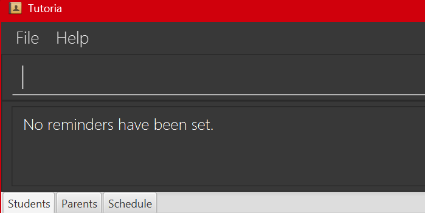
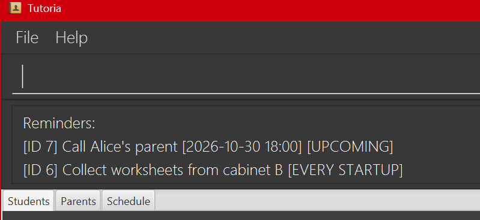
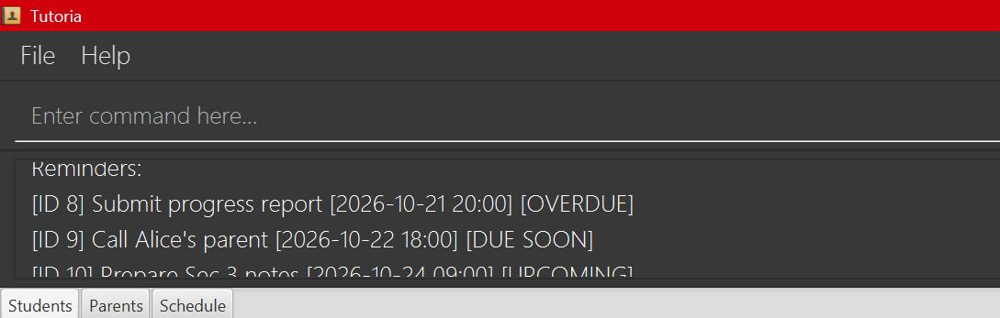
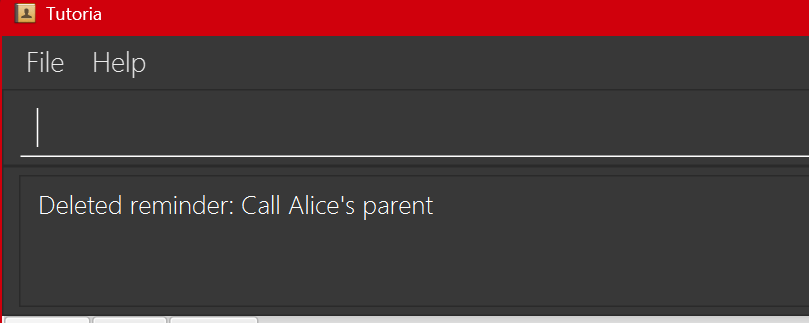

Tutoria is a **desktop application for managing students under a tutor, optimized for use through a Command Line Interface (CLI)** while retaining the benefits of a Graphical User Interface (GUI). If you type quickly, Tutoria can help you manage students faster than traditional GUI applications.

* Table of Contents
  {:toc}

--------------------------------------------------------------------------------------------------------------------

## Quick start

1. Ensure that Java `25` or later is installed on your computer.<br>
   **Mac users:** Ensure you have the precise JDK version prescribed [here](https://se-education.org/guides/tutorials/javaInstallationMac.html).

2. Download the latest `.jar` file from [here](https://github.com/se-edu/addressbook-level3/releases).

3. Copy the file to the folder you want to use as the _home folder_ for Tutoria.

4. Open a terminal, `cd` to the folder containing the JAR file, and run `java -jar Tutoria.jar`.<br>
   A GUI similar to the one below should appear in a few seconds. Note how the app contains some sample data.<br>
   

5. Type a command in the command box and press Enter to execute it. For example, type **`help`** and press Enter to see a list of all commands.<br>
   Some example commands you can try:

    * `list-students` : Lists all students.

    * `add n/John Doe p/98765432 e/johnd@example.com a/John street, block 123, #01-01` : Adds a student named `John Doe` to Tutoria.

    * `delete 3` : Deletes the 3rd student shown in the current list.

    * `clear` : Deletes all student.

    * `exit` : Exits the app.

1. Refer to the [Features](#features) section below for details of each command.

--------------------------------------------------------------------------------------------------------------------

## Features

<div markdown="block" class="alert alert-info">

** :information_source: Notes about the command format:**<br>

* Words in `UPPER_CASE` are the parameters to be supplied by the user.<br>
  For example, in `add n/NAME`, replace `NAME` with a value such as `John Doe`.

* Items in square brackets are optional.<br>
  For example, `n/NAME [t/TAG]` can be used as `n/John Doe t/friend` or as `n/John Doe`.

* Items followed by `…`​ can appear zero or more times.<br>
  For example, `[t/TAG]…​` may be omitted, or written as `t/friend` or `t/friend t/family`.

* Parameters can be in any order.<br>
  For example, if the command specifies `n/NAME p/PHONE_NUMBER`, `p/PHONE_NUMBER n/NAME` is also acceptable.

* Extraneous parameters for commands that take no parameters, such as `help`, `list-students`, `exit`, and `clear`, are ignored.<br>
  For example, `help 123` is interpreted as `help`.

* If you are using a PDF version of this document, be careful when copying and pasting commands that span multiple lines as space characters surrounding line-breaks may be omitted when copied over to the application.
</div>

### Viewing help: `help`

Shows every command in Tutoria, along with its format and what it does.

Format: `help`

* The list of commands is shown in the **Commands** tab, which `help` switches to.
* Parameters in square brackets (e.g. `[t/TAG]`) are optional, and `...` means the parameter can be used multiple times.
* For full details and examples of each command, open the **user guide** link at the top of the list, or refer to the command's section in this guide. To reach the link from the command box, press `Tab` three times, then press `Enter` or `Space` to open it.

---
### Adding a student: `add-student`

Adds a student to Tutoria.

Format: `add-student n/<NAME> p/<PHONE> e/<EMAIL> a/<ADDRESS> s/<SUBJECT> [g/<GRADE_LEVEL>] [t/<TAG>]...`

* All fields cannot be blank unless they are optional.
* `NAME` is the student's name. At most 100 characters long.
* `PHONE` is the student's phone number. It must contain 3 to 15 digits and can start with an optional + (e.g. +6591234567).
* `EMAIL` is the student's email address. It must be a valid email in the format local-part@domain.
* `ADDRESS` is the student's address and can be at most 200 characters long.
* `SUBJECT` is the subject the student is being tutored in.
* `GRADE_LEVEL` (optional) is the student's grade level, e.g. Sec 3 or P6.
* `TAG` (optional) must be alphanumeric and cannot contain spaces.

<div markdown="span" class="alert alert-primary">:bulb: **Tip:**
A student can have any number of tags, including zero.
</div>

Examples:
* `add-student n/John Tan p/91234567 e/johntan@example.com a/Blk 22 Ang Mo Kio Ave 3 s/Mathematics g/Sec 3 t/needsReminder`

---
### Adding a parent: `add-parent`

Adds a parent to Tutoria.

Format: `add-parent n/<NAME> p/<PHONE> [e/<EMAIL>] [link/<STUDENT_INDEX>] [r/<REQUIREMENT>]...`

* `NAME` is the parent’s name.
* `PHONE` is the parent’s phone number. It must contain 3 to 15 digits and may start with +.
* `EMAIL` (optional). If provided, it must be a valid email address.
* `STUDENT_INDEX` (optional) and identifies the student to link to the parent.
* `REQUIREMENT` (optional) is a parent requirement or note. It can be repeated.

Examples:
* add-parent n/Mrs Tan p/98765432 e/tanmrs@email.com link/1 r/No food during session

---
### Listing all students: `list-students`

Shows a list of all students in Tutoria.

Format: `list-students`

---
### Listing all parents: `list-parents`

Shows a list of all parents in Tutoria.

Format: `list-parents`

---
### Editing a student: `edit`

Edits an existing student.

Format: `edit INDEX [n/NAME] [p/PHONE] [e/EMAIL] [a/ADDRESS] [s/SUBJECT] [g/GRADE_LEVEL] [t/TAG]…​`

* Edits the student at the specified `INDEX`. The index refers to the index number shown in the displayed list. The index **must be a positive integer** 1, 2, 3, …​
* At least one of the optional fields must be provided.
* Existing values will be updated to the input values.
* When editing tags, all the student's existing tags are removed; adding tags is not cumulative.
* To remove all of a student's tags, enter `t/` without a tag after it.

Examples:
*  `edit 1 p/91234567 e/johndoe@example.com` Edits the phone number and email address of the 1st student to be `91234567` and `johndoe@example.com` respectively.
*  `edit 2 n/Betsy Crower t/` Edits the name of the 2nd student to be `Betsy Crower` and clears all existing tags.

---
### Editing a parent: `edit-parent`

Edits an existing parent.

Format: `edit-parent n/<NAME> p/<PHONE> [e/<EMAIL>] [link/<STUDENT_INDEX>] [r/<REQUIREMENT>]`

* Edits the student at the specified `INDEX`. The index refers to the index number shown in the displayed list. The index **must be a positive integer** 1, 2, 3, …​
* At least one of the optional fields must be provided.
* Existing values will be updated to the input values.

---
### Adding photos to a student: `add-photo`

Adds a profile photo to an existing student.

Format: `add-photo INDEX f/FILE_PATH`

* `INDEX` must be a positive integer (1, 2, 3, …).
* `INDEX` must not be larger than the number of students in the displayed list.
* The index refers to the index number shown in the displayed list.
* `FILE_PATH` is the path to the image on the user’s computer.
* The file must exist and be readable.
* The image must be in JPG, JPEG, or PNG format, and not larger than 5MB.
* The file must contain a valid image; changing a non-image file’s extension is not sufficient.
* Only one f/ prefix may be provided.
* If the student already has a photo, it is replaced.
* Tutoria stores the image’s file path, so the image may stop displaying if the original file is moved, renamed, or deleted.

Examples:
* `list-students` followed by`add-photo 2 f/C:\Users\prana\Pictures\student.png` adds the photo to the 2nd student in the list.

---
### Adding photos to a parent: `add-parent-photo`

Adds a profile photo to an existing parent.

Format: `add-parent-photo INDEX f/FILE_PATH`

* Details for the `add-photo` command apply here.

---
### Deleting photos of a student: `delete-photo`

Deletes the profile photo of an existing student.

Format: `delete-photo INDEX`

* `INDEX` must be a positive integer (1, 2, 3, …).
* `INDEX` must not be larger than the number of students in the displayed list.
* The index refers to the index number shown in the displayed list.

---
### Deleting photos of a parent: `delete-parent-photo`

Deletes the profile photo of an existing parent.

Format: `delete-parent-photo INDEX`

* `INDEX` must be a positive integer (1, 2, 3, …).
* `INDEX` must not be larger than the number of students in the displayed list.
* The index refers to the index number shown in the displayed list.

---
### Adding tasks to a student: `add-task`

Adds tasks to an existing student.

Format: `add-task <INDEX> task/<DESCRIPTION>`

* `INDEX` is the index of the student in the displayed student list.
* `DESCRIPTION` is the text of the task. It can contain spaces, but it cannot be blank.

Examples:
* `add-task 1 task/do homework`
* `add-task 2 task/revise chapter 3 notes`


---
### Adding a reminder: `add-reminder`


Adds a persistent tutor-level reminder that is not attached to any student. A reminder can be untimed or have an
optional due date and time. Duplicate reminder text is allowed.

Format: `add-reminder r/REMINDER_TEXT [at/YYYY-MM-DD HH:mm]`

* `REMINDER_TEXT` may contain spaces but must not be blank.
* `at/` is optional. When provided, it must contain a valid date and 24-hour time in `YYYY-MM-DD HH:mm` format.
* Untimed reminders are classified as `EVERY STARTUP`.
* Each reminder receives a stable positive ID that does not change when reminders are reordered or deleted.

Examples:
* `add-reminder r/Collect worksheets from cabinet B` adds an untimed reminder.
* `add-reminder r/Call Alice's parent at/2026-10-30 18:00` adds a timed reminder.

Before adding any reminders:



After adding the untimed and timed reminders:



---
### Listing reminders: `list-reminders`

Displays every reminder with its stable ID, optional due date and time, and current urgency status.

Format: `list-reminders`

If no reminders have been set, Tutoria reports that no reminders have been set. Otherwise, reminders are displayed in
this urgency order:

1. `OVERDUE`: the due time is before the current minute.
2. `DUE SOON`: the due time is within the current minute or the next 24 hours, inclusive.
3. `UPCOMING`: the due time is more than 24 hours away.
4. `EVERY STARTUP`: the reminder has no due time.

Within each timed category, reminders with the earliest due time are shown first. Reminders with the same due time are
ordered by stable ID. Untimed reminders are ordered by stable ID. Exactly 24 hours away is classified as `DUE SOON`.

Example: `list-reminders`



---
### Deleting a reminder: `delete-reminder`

Deletes exactly one reminder using the stable ID shown by `list-reminders`.

Format: `delete-reminder ID`

* `ID` must be a positive integer belonging to an existing reminder.
* The ID is not the reminder's current position in the displayed list.
* Deleting a reminder does not change the IDs of the remaining reminders, and deleted IDs are not reused.

Example: `delete-reminder 7` deletes the reminder with ID 7.



When Tutoria starts, its reminder dialog displays all saved reminders in the same urgency order as `list-reminders`.
The dialog can be closed with Enter, Escape, or its close control. Closing it only dismisses it for the current session
and does not delete reminders. Use `delete-reminder` to remove a reminder permanently.

If a timed reminder reaches its due minute while Tutoria is open, Tutoria displays an alert. Reminders reaching their
due time together are grouped into one alert. Dismissing the alert does not delete the reminders.

---
### Marking tasks as done or not: `mark-task`

Marks a task as completed or incompleted.

Format: `mark-task <INDEX> tid/<TASK_ID> status/<STATUS>`

* `INDEX` is the index of the student in the displayed student list.
* `TASK_ID` is the number shown beside the task in that student's task list (the first task is 1).
* `STATUS` is either done or not done.

Examples:
* `mark-task 1 tid/1 status/done` will color the task as green.
* `mark-task 1 tid/1 status/not done` will color the task as red.

---
### Locating students by name: `find`

Finds students whose names contain any of the given keywords.

Format: `find KEYWORD [MORE_KEYWORDS]`

* The search is case-insensitive; for example, `hans` matches `Hans`.
* Keyword order does not matter; for example, `Hans Bo` matches `Bo Hans`.
* The search considers only names.
* Only full words match; for example, `Han` does not match `Hans`.
* Students matching at least one keyword are returned (an `OR` search); for example, `Hans Bo` returns `Hans Gruber` and `Bo Yang`.

Examples:
* `find John` returns `john` and `John Doe`
* `find alex david` returns `Alex Yeoh`, `David Li`<br>
  

---
### Searching for anything: `search`

Searches for anything with the matching keyword, and highlights the keyword.

Format: `search KEYWORD`

* Everything after `search` is the keyword; for example, `Hans Bo` searches for `Hans Bo` together, and not `Hans` and `Bo` separately.
* The search is case-insensitive; for example, `hans` matches `Hans`.
* Keyword order matters; for example, `Hans Bo` does not match `Bo Hans`.
* The search considers anything that can be entered as a field in the `add` commands
* Full words don't have to match; for example, `Han` matches `Hans`.

---
### Deleting a student: `delete-student`

Deletes the specified student from Tutoria.

Format: `delete-student INDEX`

* Deletes the student at the specified `INDEX`.
* The index refers to the index number shown in the displayed list.
* The index **must be a positive integer** 1, 2, 3, …​

Examples:
* `list-students` followed by `delete-student 2` deletes the 2nd student in the list.
* `find Betsy` followed by `delete 1` deletes the 1st student in the results of the `find` command.

---
### Deleting a parent: `delete-parent`

Deletes the specified parent from Tutoria.

Format: `delete-parent INDEX`

* Deletes the parent at the specified `INDEX`.
* The index refers to the index number shown in the displayed list.
* The index **must be a positive integer** 1, 2, 3, …​

Examples:
* `list-parents` followed by `delete-parent 2` deletes the 2nd parent in the list.
* `find Betsy` followed by `delete 1` deletes the 1st parent in the results of the `find` command.

---
### Undoing a command: `undo`

Reverses the last command that modified Students or Parents.

Format: `undo`

* Since the commands `list-students`, `find`, `search`, `clear`, `help` or `exit` does not modify any student or parent values, `undo` reverses their commands but does not modify anything.

Examples:
* `edit 1 n/John` followed by `undo` will first change the first student's name to `John`, and `undo` changes it to what it was before.
* `edit 1 n/John`,`list-students`, `undo` and `undo` will change the first student's name to `John`, list all students, then the first `undo` does nothing since `list-students` does not change anything, and the second `undo` changes `John` to what it was before.

---
### Redoing a command: `redo`

Reverses the last `undo` command.

Format: `redo`

* Since undoing the commands `list-students`, `find`, `search`, `clear`, `help` or `exit` does not modify any student or parent values, `redo` reverses their commands but does not modify anything.

Examples:
* `edit 1 n/John`, `undo` and then `redo` will first change the first student's name to `John`, `undo` reverses the name change, and `redo` reverses the `undo` command, changing the name back to `John`.
* `list-students`, `undo` and then `redo` will first list all students, then `undo` and `redo` does nothing since `list-students` does not change anything.

### Historical lessons and assessments

Tutoria can measure recorded teaching workload and student progress. The business report measures workload,
**not profitability**: it does not track payments, expenses, or profit. Weekly scheduled sessions are plans;
Tutoria never assumes they happened and never converts them into historical records automatically.

Student `INDEX` values refer to the currently displayed Students list, including any `find` or `search` filter.
Sessions, lessons and assessments use separate numbered lists starting at 1. Their stable identities are kept
internally; commands use the displayed numbers. Student identity survives edits and saves.

Session and historical record numbers refer to the current complete list, regardless of student search filters.
Numbers can shift after deletion, unscheduling, `clear`, undo or redo: run the relevant list command again before
choosing a record. Editing a record keeps its position; new records are appended in recording order.

#### Recording attendance from the weekly timetable

Use the recurring Schedule tab to plan lessons once, then record an outcome for an individual date:

```
list-schedule
mark-attendance SESSION_NUMBER date/YYYY-MM-DD status/STATUS
```

`list-schedule` opens the existing Schedule tab and lists every session's number, student, subject, weekday and
times in the command-result area, regardless of student search filters. Each timetable card shows `Session #N`,
matching that list even though the timetable arranges cards by weekday and time. The `Student:` label is separate:
its index refers to the Students list, not the session number used for attendance.
No student index is needed for attendance because each session already belongs to one student.

For example, if the first listed session is a Monday lesson, use
`mark-attendance 1 date/2026-10-19 status/completed`.
The date must match the session's weekday and cannot be later than today. Today's attendance can be marked regardless
of the current time. Available statuses are `completed`, `absent`, `cancelled` and `unrecorded` (case-insensitive).
The command opens the Schedule tab and confirms the student's name, date, times, outcome and lesson number.

* First marking creates a dated lesson with the student's current subject and the session's times.
* Marking the same session and date again changes only its outcome, preserving the lesson's identity and details.
  Later weeks use different dates and therefore create separate records.
* Unmarked timetable occurrences create no history and are not counted in statistics, even as `unrecorded`.
* Editing a student, removing a recurring session or deleting the student does not rewrite recorded lessons.
  Recreating a removed weekly slot creates a new session. Existing history remains available through `list-lessons`.
* Duplicate weekly slots have separate numbers; check that you are marking the intended one. Unscheduling by student/day/time
  removes the first matching slot, as before.
* Attendance updates support undo/redo. `list-schedule` is read-only and preserves redo history.

#### Recording additional lessons: `record-lesson`

Format: `record-lesson INDEX date/YYYY-MM-DD from/HH:mm to/HH:mm status/STATUS`

Example: `record-lesson 1 date/2026-10-01 from/10:00 to/11:30 status/completed`

* Status is `completed`, `absent`, `cancelled`, or `unrecorded` (case-insensitive).
* `unrecorded` explicitly means the outcome is unknown; a weekly session is never counted as unrecorded automatically.
* The subject is copied from the student's subject at recording time. Later student edits do not rewrite history.
* Dates must exist and cannot be after today. Times use 24-hour `HH:mm`; start must be before end on the same day.
  Overnight lessons are unsupported. Today's records are allowed regardless of the current time.
* The success message contains the lesson number. Each invocation creates a separate record: check for duplicates yourself.
* Use this for extra or replacement lessons outside the timetable. Manual records are not automatically linked or
  merged with attendance records, so avoid recording the same lesson both ways.

#### Recording assessment marks: `record-assessment`

Format: `record-assessment INDEX date/YYYY-MM-DD subject/SUBJECT category/CATEGORY title/TITLE score/SCORE max/MAX`

Example: `record-assessment 1 date/2026-10-01 subject/Mathematics category/Quiz title/Fractions score/18 max/25`

The date cannot be in the future. Subject, category and title must be nonblank single-line text. Decimal marks
are allowed; `max` must be positive, and `score` must be between zero and `max`, inclusive.
Fields are entered once each; unknown or repeated prefixes are rejected. Text must not contain a whitespace-separated
word ending in `/`, which is reserved for command argument prefixes.

#### Viewing and correcting history

* `list-lessons` lists all dated lessons, including the lesson number, student name, date, times, subject and outcome.
* `list-assessments` lists all dated assessments, including the assessment number, student name, date, subject,
  category, title and raw marks.
* Lists include all dates and students, regardless of search filters, in recording order. They take no arguments.
* Use the number from the appropriate list when correcting or deleting an entry. Corrections replace all editable
  fields and preserve the internal identity and student link; they also work after the student has been deleted.

Correction formats:

```
edit-lesson LESSON_NUMBER date/YYYY-MM-DD from/HH:mm to/HH:mm status/STATUS subject/SUBJECT
edit-assessment ASSESSMENT_NUMBER date/YYYY-MM-DD subject/SUBJECT category/CATEGORY title/TITLE score/SCORE max/MAX
delete-lesson LESSON_NUMBER
delete-assessment ASSESSMENT_NUMBER
```

For example, to correct the third lesson shown by `list-lessons`, run
`edit-lesson 3 date/2026-10-01 from/10:00 to/11:30 status/absent subject/Mathematics`.
`delete-assessment 2` deletes the second item from `list-assessments`, independently of lesson or student numbers.
Only positive integer numbers are accepted, not internal UUIDs.
If an entry belongs to the wrong student, delete it and record it again using the correct displayed student index.
Lessons created by `mark-attendance` remain linked internally to their weekly session. `edit-lesson` can correct the
subject, times or status, but its date must stay the same. To change the date, delete the mistaken record, then mark
attendance for the correct date (or use `record-lesson` for an extra lesson outside the weekly slot).
Recording, correction and deletion support `undo` and `redo`.

Deleting a student preserves their history. Lists show their retained name with a `(deleted)` label.
Recreating a student with the same name creates a new identity and does not inherit old history.
Deleted students still contribute to business workload; `stats-student` requires an existing displayed student.

#### Business workload: `stats`

Format: `stats [from/YYYY-MM-DD to/YYYY-MM-DD]`

Example: `stats from/2026-01-01 to/2026-10-21`

Shows completed lesson count, completed teaching hours, distinct students taught, and the same figures by calendar
month (including months with zero completed lessons). Only completed lessons count toward workload. Hours use
recorded durations; they do not represent revenue or profit. Business statistics use **all** history, regardless
of the current student search filter.

#### Student progress: `stats-student`

Format: `stats-student INDEX [from/YYYY-MM-DD to/YYYY-MM-DD]`

Example: `stats-student 1 from/2026-01-01 to/2026-10-21`

Shows completed, absent, cancelled and unrecorded counts, attendance rate, dated assessment percentages, and
earliest-to-latest percentage-point change for each matching subject and category.

* Attendance = completed / (completed + absent) × 100. Cancelled and unrecorded lessons are counted separately,
  and excluded from the denominator. With no completed or absent lessons, attendance is `N/A`.
* Assessment percentage = score / max × 100. For each subject/category group, change is the latest percentage
  minus the earliest, not an average or a relative percentage increase. Fewer than two records gives `N/A`.
* Subject and category matching ignores case and surrounding spaces. Assessments sort by date and then stable
  record ID for ties on the same date. Two assessments on the same date can therefore be compared deterministically.
* Displayed hours, percentages and percentage-point changes round to two decimals; intermediate percentages use
  twelve decimals before calculating changes. Different subjects or categories are never combined.

Both report commands require `from` and `to` together, with `from` on or before `to`; both dates are inclusive.
When omitted, the range is January 1 of the current year through today, using the app clock and local time zone.
Explicit ranges may include future dates, but historical records cannot be recorded in the future.
Reports, history lists and `list-schedule` appear as scrollable text in the existing command-result area. They do not save data,
create undo steps or discard redo history.

Older data files load with empty history. Tutoria does not fabricate past activity from existing students or schedules.
Only source records, not calculated totals, are saved in `data/addressbook.json`.

---
### Clearing all entries: `clear`

Clears all entries from Tutoria, including historical records. Use `delete-student` to retain a student's history.

Format: `clear`

---
### Exiting the program: `exit`

Exits the program.

Format: `exit`

---
### Saving the data

Tutoria automatically saves data after commands other than read-only statistics, historical lists and `list-schedule`.
You do not need to save manually.

### Editing the data file

Tutoria data is saved as `data/addressbook.json` relative to the working folder where you launch it.
Advanced users can edit this file, but should preserve student and historical record UUIDs and back it up first.

<div markdown="span" class="alert alert-warning">:exclamation: **Caution:**
If your changes make the data file invalid, Tutoria starts empty at the next run. The invalid file remains on disk until you run a command (Tutoria saves after every command). Still, we recommend backing up the file before editing it.<br>
Furthermore, certain edits can cause the  to behave in unexpected ways (e.g., if a value entered is outside the acceptable range). Therefore, edit the data file only if you are confident that you can update it correctly.
</div>Tutoria

--------------------------------------------------------------------------------------------------------------------

## FAQ

**Q**: How do I transfer my data to another computer?<br>
**A**: Install the app on the other computer and overwrite the data file it creates with the data file from your previous Tutoria home folder.

--------------------------------------------------------------------------------------------------------------------

## Known issues

1. **When using multiple screens**, if you move the application to a secondary screen, and later switch to using only the primary screen, the GUI will open off-screen. The remedy is to delete the `preferences.json` file created by the application before running the application again.
2. **If you minimize the Help Window** and then run the `help` command (or use the `Help` menu, or the keyboard shortcut `F1`) again, the original Help Window will remain minimized, and no new Help Window will appear. The remedy is to manually restore the minimized Help Window.

--------------------------------------------------------------------------------------------------------------------

## Command summary

Statistics commands: `record-lesson`, `record-assessment`, `list-lessons`, `list-assessments`, `edit-lesson`,
`edit-assessment`, `delete-lesson`, `delete-assessment`, `stats`, and `stats-student`.
Scheduled attendance: `list-schedule` and `mark-attendance SESSION_NUMBER date/YYYY-MM-DD status/STATUS`.
See [Historical lessons and assessments](#historical-lessons-and-assessments) for syntax and examples.

| Action                   | Format, Examples                                                                                                                                                                                                                       |
|--------------------------|----------------------------------------------------------------------------------------------------------------------------------------------------------------------------------------------------------------------------------------|
| **Add student**          | `add-student n/<NAME> p/<PHONE> e/<EMAIL> a/<ADDRESS> s/<SUBJECT> [g/<GRADE_LEVEL>] [t/<TAG>]...` <br> e.g., `add-student n/John Tan p/91234567 e/johntan@example.com a/Blk 22 Ang Mo Kio Ave 3 s/Mathematics g/Sec 3 t/needsReminder` |
| **Add parent**           | `add-parent n/<NAME> p/<PHONE> [e/<EMAIL>] [link/<STUDENT_INDEX>] [r/<REQUIREMENT>]...` <br/> e.g., `add-parent n/Mrs Tan p/98765432 e/tanmrs@email.com link/1 r/No food during session`                                               |
| **Clear**                | `clear`                                                                                                                                                                                                                                |
| **Delete**               | `delete INDEX`<br> e.g., `delete 3`                                                                                                                                                                                                    |
| **Edit student**         | `edit INDEX [n/NAME] [p/PHONE] [e/EMAIL] [a/ADDRESS] [s/SUBJECT] [g/GRADE_LEVEL] [t/TAG]…​`<br> e.g., `edit 1 p/91234567 e/johndoe@example.com`                                                                                        |
| **Edit parent**          | `edit-parent` <br/> e.g., `edit-parent 1 n/Mrs.Tan`                                                                                                                                                                                    |
| **Add student photo**    | `add-photo INDEX f/FILE_PATH` <br/> e.g., `add-photo 2 f/C:\Users\prana\Pictures\studentName.png`                                                                                                                                      |
| **Add parent photo**     | `add-parent-photo INDEX f/FILE_PATH` <br/> e.g., `add-photo 2 f/C:\Users\prana\Pictures\parentName.png`                                                                                                                                |
| **Delete student photo** | `delete-photo INDEX` <br/> e.g., `delete-photo 1`                                                                                                                                                                                      | 
| **Delete parent photo**  | `delete-parent-photo INDEX` <br/> e.g., `delete-parent-photo 1`                                                                                                                                                                        |
| **Add task**             | `add-task <INDEX> task/<DESCRIPTION>` <br/> e.g., `add-task 1 task/do homework`                                                                                                                                                        |
| **Find**                 | `find KEYWORD [MORE_KEYWORDS]`<br> e.g., `find James Jake`                                                                                                                                                                             |
| **List students**        | `list`                                                                                                                                                                                                                                 |
| **List parents**         | `list-parents`                                                                                                                                                                                                                         |
| **Mark task**            | `mark-task <INDEX> tid/<TASK_ID> status/<STATUS>` <br/> e.g., `mark-task 1 tid/1 status/done`                                                                                                                                          |
| **Delete student**       | `delete-student INDEX` <br/> e.g., `delete-student 1`                                                                                                                                                                                  |
| **Delete parent**        | `delete-parent INDEX` <br/> e.g., `delete-parent 1`                                                                                                                                                                                    |
| **Help**                 | `help`                                                                                                                                                                                                                                 |
| **Search**               | `search KEYWORD` <br/> e.g. `search John`                                                                                                                                                                                              |
| **Undo**                 | `undo`                                                                                                                                                                                                                                 |
| **Redo**                 | `redo`                                                                                                                                                                                                                                 |
| **Add reminder**         | `add-reminder r/REMINDER_TEXT`<br> e.g., `add-reminder r/Collect worksheets from cabinet B`                                                                                                                                            |
| **List reminders**       | `list-reminders`                                                                                                                                                                                                                       |
| **Delete reminder**      | `delete-reminder INDEX`<br> e.g., `delete-reminder 2`                                                                                                                                                                                  |
