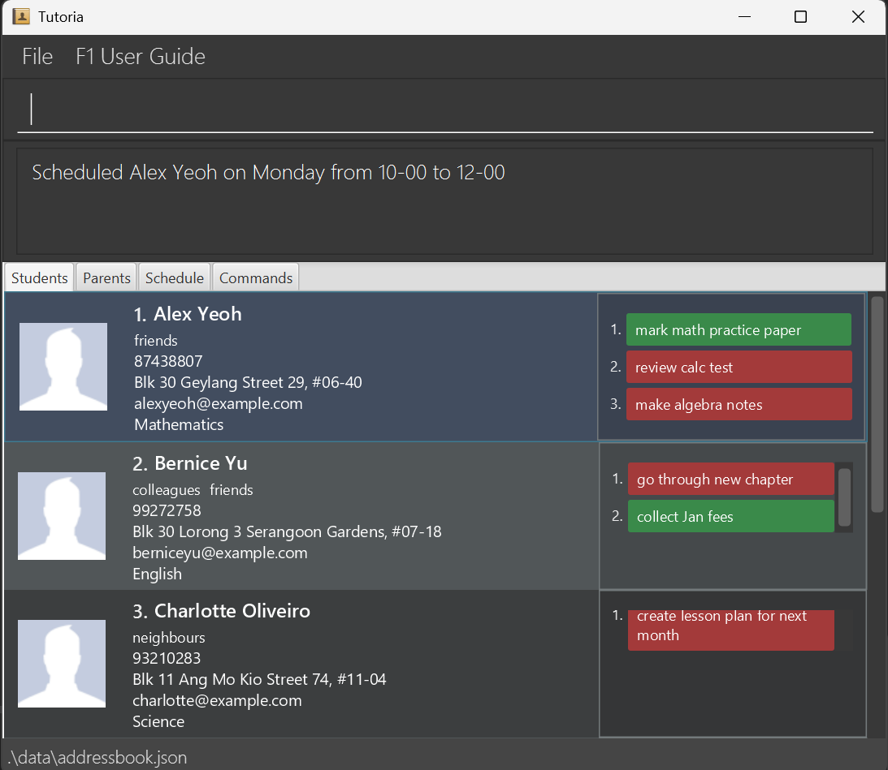

Tutoria is a **desktop application designed to help tutors manage students, parents, lessons, and teaching-related activities**. It is optimized for use through a Command Line Interface (CLI), while retaining the convenience of a Graphical User Interface (GUI).

Tutoria helps tutors maintain student and parent records, manage tasks and reminders, schedule lessons, record attendance and assessments, and view statistics on student progress and teaching workload.

* [Quick start](#quick-start)
* [Features](#features)
  * [General commands](#general-commands)
  * [Student management](#student-management)
  * [Parent management](#parent-management)
  * [Photos](#photos)
  * [Tasks](#tasks)
  * [Reminders](#reminders)
  * [Scheduling and attendance](#scheduling-and-attendance)
  * [Assessments and statistics](#assessments-and-statistics)
  * [Data management](#data-management)
* [FAQ](#faq)
* [Known issues](#known-issues)
* [Command summary](#command-summary)

--------------------------------------------------------------------------------------------------------------------

## Quick start

1. Ensure that Java `25` is installed on your computer. You can verify this by running `java -version` in a terminal.

2. Download the latest `tutoria.jar` file from the [Tutoria releases page](https://github.com/AY2627S1-CS2103T-F09-4/tp/releases).

3. Copy the file to the folder you want to use as the _home folder_ for Tutoria.

4. Open a terminal, `cd` to the folder containing the JAR file, and run `java -jar tutoria.jar`. 
   A GUI similar to the one below should appear in a few seconds. Note how the app contains some sample data. 
   

5. Type a command in the command box and press Enter to execute it. For example, type **`help`** and press Enter to see a list of all commands. 
   Some example commands you can try:

    * `list-students` : Lists all students.

    * `add-student n/John Doe p/98765432 e/johnd@example.com a/John street, block 123, #01-01 s/Mathematics` : Adds a student named `John Doe` to Tutoria.

    * `delete-student 3` : Deletes the 3rd student shown in the current list.

    * `list-parents` : Lists all parents.

    * `exit` : Exits the app.

1. Refer to the [Features](#features) section below for details of each command.

--------------------------------------------------------------------------------------------------------------------

## Features

**Notes about the command format:**

* Words in `UPPER_CASE` are the parameters to be supplied by the user. 
  For example, in `add-student n/<NAME>`, replace `NAME` with a value such as `John Doe`.

* Items in square brackets are optional. 
  For example, `n/<NAME> [t/<TAG>]` can be used as `n/John Doe t/friend` or as `n/John Doe`.

* Items followed by `...` can appear zero or more times. 
  For example, `[t/<TAG>]...` may be omitted, or written as `t/friend` or `t/friend t/family`.

* Parameters can be in any order. 
  For example, if the command specifies `n/<NAME> p/<PHONE>`, `p/<PHONE> n/<NAME>` is also acceptable.

* Extraneous parameters for commands that take no parameters, such as `help`, `list-students`, `exit`, and `clear`, are ignored. 
  For example, `help 123` is interpreted as `help`.

* If you are using a PDF version of this document, be careful when copying and pasting commands that span multiple lines as space characters surrounding line-breaks may be omitted when copied over to the application.

### General commands

#### Viewing help: `help`
Shows all available commands.

Format: `help`

#### Undoing a command: `undo`
Reverses the most recent command that changed data.

Format: `undo`

#### Redoing a command: `redo`
Reapplies the most recent command reversed by `undo`.

Format: `redo`

#### Exiting the program: `exit`
Exits Tutoria.

Format: `exit`

### Student management

#### Adding a student: `add-student`
Adds a student to Tutoria.

Format: `add-student n/<NAME> p/<PHONE> e/<EMAIL> a/<ADDRESS> s/<SUBJECT> [g/<GRADE_LEVEL>] [t/<TAG>]...`

* `NAME` and `ADDRESS` must not be blank.
* `PHONE` must contain 3 to 15 digits and may start with `+`.
* `EMAIL` must be a valid email address.
* `TAG` is optional, must be alphanumeric, and may be repeated.

Example: `add-student n/John Tan p/91234567 e/johntan@example.com a/Blk 22 Ang Mo Kio Ave 3 s/Mathematics g/Sec 3`

#### Listing all students: `list-students`
Shows all students.

Format: `list-students`

#### Editing a student: `edit`
Edits an existing student. At least one optional field must be supplied.

Format: `edit INDEX [n/<NAME>] [p/<PHONE>] [e/<EMAIL>] [a/<ADDRESS>] [s/<SUBJECT>] [g/<GRADE_LEVEL>] [t/<TAG>]...`

Example: `edit 1 p/91234567 s/Science`

#### Deleting a student: `delete-student`
Deletes the student at the displayed index.

Format: `delete-student INDEX`

`INDEX` must be a positive integer referring to the currently displayed student list. If the list is filtered, the index refers to the filtered results.

#### Locating students by name: `find`
Finds students whose names contain any supplied keyword.

Format: `find KEYWORD [MORE_KEYWORDS]`

* The search is case-insensitive.
* Keyword order does not matter.
* Only student names are searched.
* Students matching at least one keyword are returned.

Example: `find alex david`

#### Searching details: `search`
Searches supported student and parent details and highlights matches.

Format: `search KEYWORD [MORE_KEYWORDS]...`

The search is case-insensitive and covers supported student and parent details. Unlike `find`, the complete search text is treated as the search keyword.

Example: `search Mathematics`

### Parent management

#### Adding a parent: `add-parent`
Adds a parent and can optionally link the parent to a student.

Format: `add-parent n/<NAME> p/<PHONE> [e/<EMAIL>] [link/<STUDENT_INDEX>] [r/<REQUIREMENT>]...`

* `PHONE` may contain 3 to 15 digits and may start with `+`.
* `EMAIL` is optional but must be valid when supplied.
* `link/` identifies a student in the displayed student list.
* Requirements are optional and may be repeated.

Example: `add-parent n/Mrs Tan p/98765432 e/tan@example.com link/1 r/No food during session`

#### Listing all parents: `list-parents`
Shows all parents.

Format: `list-parents`

#### Editing a parent: `edit-parent`
Edits an existing parent.

Format: `edit-parent INDEX [n/<NAME>] [p/<PHONE>] [e/<EMAIL>]`

`INDEX` must be a positive integer referring to the displayed parent list. At least one optional field must be supplied.

#### Deleting a parent: `delete-parent`
Deletes the parent at the displayed index.

Format: `delete-parent INDEX`

### Photos

#### Adding a student photo: `add-photo`
Adds or replaces a student's photo.

Format: `add-photo INDEX f/<FILE_PATH>`

* `INDEX` must refer to an existing student.
* The file must exist, be readable, and be a valid JPG, JPEG, or PNG image no larger than 5 MB.
* If a photo already exists, it is replaced.
* Moving or deleting the original file may make the photo unavailable.

#### Deleting a student photo: `delete-photo`
Deletes a student's photo.

Format: `delete-photo INDEX`

`INDEX` must be a positive integer referring to the displayed student list.

#### Adding a parent photo: `add-parent-photo`
Adds or replaces a parent's photo.

Format: `add-parent-photo INDEX f/<FILE_PATH>`

The file requirements described for `add-photo` apply, but the index refers to the displayed parent list.

#### Deleting a parent photo: `delete-parent-photo`
Deletes a parent's photo.

Format: `delete-parent-photo INDEX`

`INDEX` must be a positive integer referring to the displayed parent list.

### Tasks

#### Adding a task: `add-task`
Adds a task to a student.

Format: `add-task INDEX task/<DESCRIPTION>`

`INDEX` refers to the displayed student list. The description may contain spaces but must not be blank.

Example: `add-task 1 task/Prepare revision worksheet`

#### Marking a task: `mark-task`
Marks a task as done or not done.

Format: `mark-task INDEX tid/<TASK_ID> status/(done|not done)`

`TASK_ID` is the number shown beside the task in that student's task list. The status must be `done` or `not done`.

Example: `mark-task 1 tid/1 status/done`

#### Deleting a task: `delete-task`
Deletes a task from a student's task list.

Format: `delete-task INDEX tid/<TASK_ID>`

`INDEX` identifies the student and `TASK_ID` identifies the task within that student's task list.

### Reminders

#### Adding a reminder: `add-reminder`
Adds a tutor-level reminder.

Format: `add-reminder r/<REMINDER_TEXT> [at/YYYY-MM-DD HH:mm]`

* Reminder text must not be blank.
* The optional time uses 24-hour `YYYY-MM-DD HH:mm` format.
* Untimed reminders are classified as `EVERY STARTUP`.
* Each reminder receives a stable ID.

Example: `add-reminder r/Collect worksheets at/2026-10-30 18:00`

#### Listing reminders: `list-reminders`
Lists reminders in urgency order.

Format: `list-reminders`

Reminders are classified as `OVERDUE`, `DUE SOON`, `UPCOMING`, or `EVERY STARTUP`. Timed reminders are ordered by urgency and due time.

#### Deleting a reminder: `delete-reminder`
Deletes a reminder using its stable ID.

Format: `delete-reminder ID`

### Scheduling and attendance

#### Scheduling a weekly lesson: `schedule-student`
Schedules a recurring weekly lesson.

Format: `schedule-student INDEX day/DAY from/HH-mm to/HH-mm`

`INDEX` refers to the displayed student list. `DAY` is a weekday, times use 24-hour `HH-mm` format, and the end time must be later than the start time.

Example: `schedule-student 1 day/Monday from/16-00 to/18-00`

#### Listing scheduled lessons: `list-schedule`
Lists recurring sessions and their session numbers.

Format: `list-schedule`

The session numbers shown by this command are the numbers required by `mark-attendance`. They are separate from student indexes.

#### Removing a scheduled lesson: `unschedule-student`
Removes a matching recurring lesson.

Format: `unschedule-student INDEX day/DAY from/HH-mm to/HH-mm`

The first matching weekly session is removed. Previously recorded lessons are not deleted.

#### Recording attendance: `mark-attendance`
Records the outcome of a scheduled session for a date.

Format: `mark-attendance SESSION_NUMBER date/YYYY-MM-DD status/(completed|absent|cancelled|unrecorded)`

* Obtain `SESSION_NUMBER` from `list-schedule`.
* The date must match the session weekday and cannot be later than today.
* Repeating the command for the same session and date updates the outcome.
* Available statuses are `completed`, `absent`, `cancelled`, and `unrecorded`.

Example: `mark-attendance 1 date/2026-10-19 status/completed`

### Assessments and statistics

#### Recording an assessment: `record-assessment`
Records an assessment result.

Format: `record-assessment INDEX date/YYYY-MM-DD subject/SUBJECT category/CATEGORY title/TITLE score/SCORE max/MAX`

* The date cannot be in the future.
* Subject, category, and title must not be blank.
* `max` must be positive, and `score` must be between zero and `max`.

Example: `record-assessment 1 date/2026-10-01 subject/Mathematics category/Quiz title/Fractions score/18 max/25`

#### Listing assessments: `list-assessments`
Lists all recorded assessments.

Format: `list-assessments`

The assessment number shown by this command is used by `edit-assessment` and `delete-assessment`. The list is independent of student search filters.

#### Editing an assessment: `edit-assessment`
Replaces an assessment record.

Format: `edit-assessment RECORD_NUMBER date/YYYY-MM-DD subject/SUBJECT category/CATEGORY title/TITLE score/SCORE max/MAX`

`RECORD_NUMBER` comes from `list-assessments`. The command replaces the assessment's editable details.

#### Deleting an assessment: `delete-assessment`
Deletes an assessment record.

Format: `delete-assessment RECORD_NUMBER`

`RECORD_NUMBER` comes from `list-assessments` and is not a student index or internal ID.

#### Viewing overall workload: `stats`
Shows workload statistics.

Format: `stats [from/YYYY-MM-DD to/YYYY-MM-DD]`

If no range is supplied, the default is January 1 of the current year through today. If a range is supplied, both dates are required and inclusive. The report measures workload, not profit.

#### Viewing student progress: `stats-student`
Shows attendance and assessment progress for a student.

Format: `stats-student INDEX [from/YYYY-MM-DD to/YYYY-MM-DD]`

`INDEX` refers to the displayed student list. Date ranges follow the same rules as `stats`: both dates must be supplied together and are inclusive.

#### Listing recorded lessons: `list-lessons`
Lists all recorded lessons.

Format: `list-lessons`

This lists recorded lessons, not merely scheduled sessions. The list includes lessons from all students and is independent of student search filters.

### Data management

#### Clearing all entries: `clear`
Deletes all entries from Tutoria.

Format: `clear`

This removes students, parents, tasks, reminders, schedules, and historical records. Use `delete-student` instead if you want to preserve a student's history.

--------------------------------------------------------------------------------------------------------------------
## FAQ

**Q**: How do I transfer my data to another computer? 
**A**: Install Tutoria on the other computer and copy `data/addressbook.json` from the previous Tutoria home folder. Back up the destination file first.

**Q**: Where is my data stored? 
**A**: Tutoria stores data in `data/addressbook.json`, relative to the folder where the application is launched.

**Q**: Does Tutoria save my data automatically? 
**A**: Yes. Tutoria saves data automatically after commands that modify saved data. There is no separate save command.

**Q**: How do I know which index to use? 
**A**: Run `list-students` or `list-parents` and use the index shown beside the relevant entry. Student indexes also follow the currently displayed results after `find` or `search`.

**Q**: What is the difference between `find` and `search`? 
**A**: `find` searches student names using full-word matching. `search` searches supported student and parent details and highlights matches.

**Q**: How do I undo or redo a change? 
**A**: Enter `undo` to reverse the most recent change. Enter `redo` to reapply an undone change.

**Q**: How do I add or remove a profile photo? 
**A**: Use `add-photo INDEX f/FILE_PATH` or `add-parent-photo INDEX f/FILE_PATH` to add or replace a photo. Use `delete-photo INDEX` or `delete-parent-photo INDEX` to remove one.

**Q**: What is the difference between a scheduled session and a recorded lesson? 
**A**: `schedule-student` creates a recurring weekly plan. A lesson is recorded only when `mark-attendance` is used for a specific date.

**Q**: How do I record attendance? 
**A**: Run `list-schedule` to find the session number, then use `mark-attendance SESSION_NUMBER date/YYYY-MM-DD status/STATUS`.

**Q**: How do I correct an assessment? 
**A**: Run `list-assessments`, then use `edit-assessment RECORD_NUMBER ...` with the corrected details. Use `delete-assessment RECORD_NUMBER` to remove it.

**Q**: Why might historical data be empty in an older data file? 
**A**: Tutoria does not reconstruct lessons or assessments from existing students or schedules. Historical records must have been recorded in Tutoria.

**Q**: How do I open the User Guide? 
**A**: Enter `help`, press `F1`, or use the **F1 User Guide** menu option.

--------------------------------------------------------------------------------------------------------------------

## Known issues

1. **When using multiple screens**, the GUI may reopen off-screen after switching back to a single display. Delete the `preferences.json` file before restarting Tutoria.
2. **If you minimize the Help Window**, it may remain minimized when `F1` or the **F1 User Guide** menu is used again. Restore the minimized window manually.
3. **Photo previews depend on the original image path.** If the image is moved, renamed, or deleted, Tutoria may no longer display the photo. Add the photo again using its new path.
4. **Older data files may not contain historical records.** Tutoria does not reconstruct lessons or assessments from existing students or schedules.
5. **Invalid manual data-file edits may cause data loss.** If `data/addressbook.json` becomes invalid, Tutoria may start with an empty dataset. Back up the file before editing it.
6. **Displayed record numbers may change.** Session, lesson, and assessment numbers can change after deletion, clearing, undo, or redo. Run the relevant list command again before selecting a number.

--------------------------------------------------------------------------------------------------------------------

## Command summary

### General commands

| Command | Format / example |
|---|---|
| `help` | `help` |
| `undo` | `undo` |
| `redo` | `redo` |
| `exit` | `exit` |

### Student management

| Command | Format / example |
|---|---|
| `add-student` | `add-student n/<NAME> p/<PHONE> e/<EMAIL> a/<ADDRESS> s/<SUBJECT> [g/<GRADE_LEVEL>] [t/<TAG>]...` |
| `list-students` | `list-students` |
| `edit` | `edit INDEX [n/<NAME>] [p/<PHONE>] [e/<EMAIL>] [a/<ADDRESS>] [s/<SUBJECT>] [g/<GRADE_LEVEL>] [t/<TAG>]...` |
| `delete-student` | `delete-student INDEX` |
| `find` | `find KEYWORD [MORE_KEYWORDS]` |
| `search` | `search KEYWORD [MORE_KEYWORDS]...` |

### Parent management

| Command | Format / example |
|---|---|
| `add-parent` | `add-parent n/<NAME> p/<PHONE> [e/<EMAIL>] [link/<STUDENT_INDEX>] [r/<REQUIREMENT>]...` |
| `list-parents` | `list-parents` |
| `edit-parent` | `edit-parent INDEX [n/<NAME>] [p/<PHONE>] [e/<EMAIL>]` |
| `delete-parent` | `delete-parent INDEX` |

### Photos

| Command | Format / example |
|---|---|
| `add-photo` | `add-photo INDEX f/<FILE_PATH>` |
| `delete-photo` | `delete-photo INDEX` |
| `add-parent-photo` | `add-parent-photo INDEX f/<FILE_PATH>` |
| `delete-parent-photo` | `delete-parent-photo INDEX` |

### Tasks

| Command | Format / example |
|---|---|
| `add-task` | `add-task INDEX task/<DESCRIPTION>` |
| `mark-task` | `mark-task INDEX tid/<TASK_ID> status/(done\|not done)` |
| `delete-task` | `delete-task INDEX tid/<TASK_ID>` |

### Reminders

| Command | Format / example |
|---|---|
| `add-reminder` | `add-reminder r/<REMINDER_TEXT> [at/YYYY-MM-DD HH:mm]` |
| `list-reminders` | `list-reminders` |
| `delete-reminder` | `delete-reminder ID` |

### Scheduling and attendance

| Command | Format / example |
|---|---|
| `schedule-student` | `schedule-student INDEX day/DAY from/HH-mm to/HH-mm` |
| `list-schedule` | `list-schedule` |
| `unschedule-student` | `unschedule-student INDEX day/DAY from/HH-mm to/HH-mm` |
| `mark-attendance` | `mark-attendance SESSION_NUMBER date/YYYY-MM-DD status/(completed\|absent\|cancelled\|unrecorded)` |

### Assessments and statistics

| Command | Format / example |
|---|---|
| `record-assessment` | `record-assessment INDEX date/YYYY-MM-DD subject/SUBJECT category/CATEGORY title/TITLE score/SCORE max/MAX` |
| `list-assessments` | `list-assessments` |
| `edit-assessment` | `edit-assessment RECORD_NUMBER date/YYYY-MM-DD subject/SUBJECT category/CATEGORY title/TITLE score/SCORE max/MAX` |
| `delete-assessment` | `delete-assessment RECORD_NUMBER` |
| `stats` | `stats [from/YYYY-MM-DD to/YYYY-MM-DD]` |
| `stats-student` | `stats-student INDEX [from/YYYY-MM-DD to/YYYY-MM-DD]` |
| `list-lessons` | `list-lessons` |

### Data management

| Command | Format / example |
|---|---|
| `clear` | `clear` |

